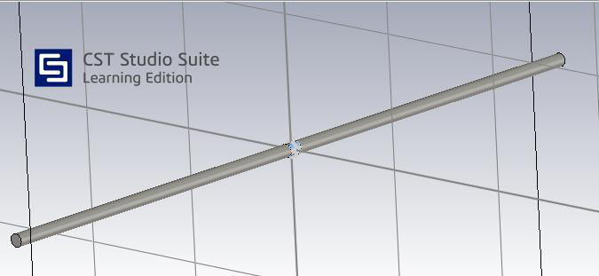
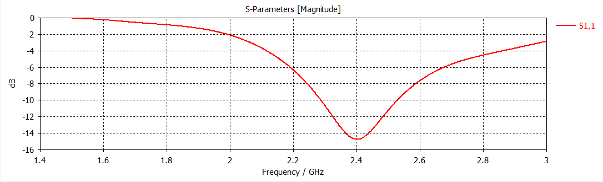
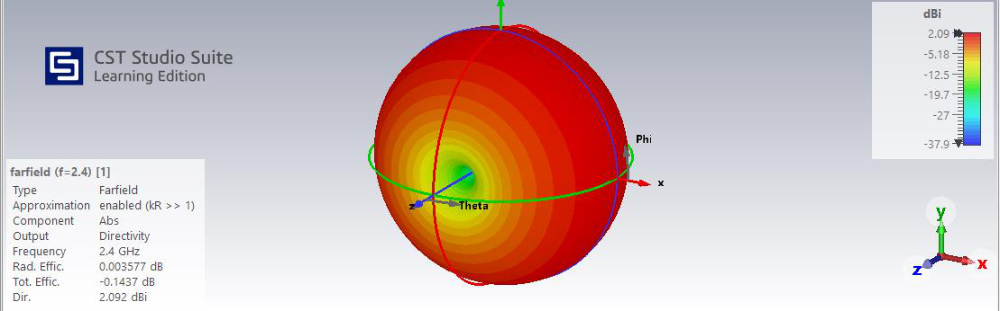
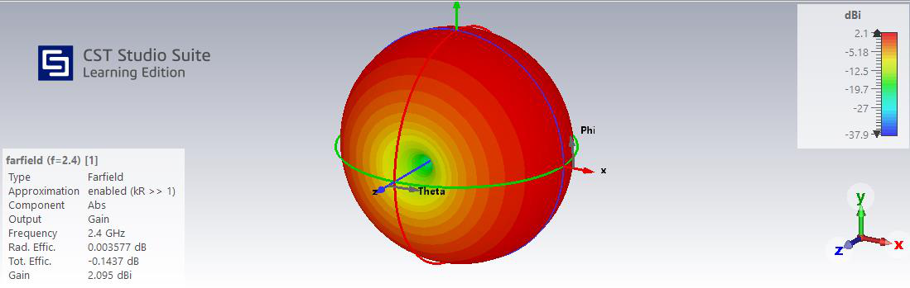
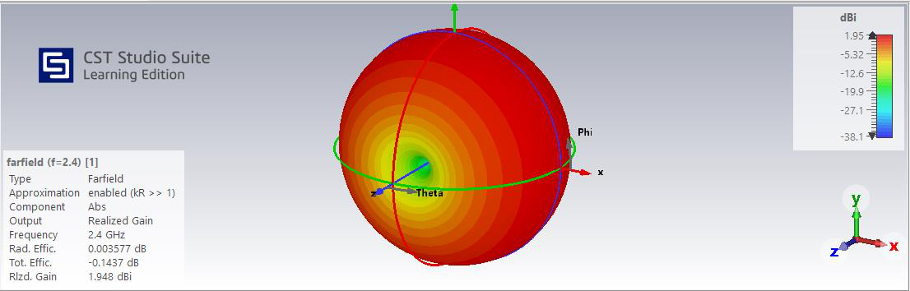
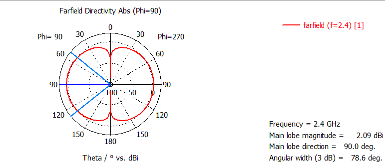

# 2.4 GHz Yarım Dalga Dipol Anten — CST Simülasyonu

Bu depo, **2.4 GHz frekansında çalışan yarım dalga dipol antenin** teorik boyutlandırmasını, **CST Studio Suite Learning Edition** ortamındaki tasarımını, geometrik optimizasyonunu ve simülasyon sonuçlarını sunar.

**[English README](README.md)** · **[Tam teknik rapor (PDF)](report/2.4GHz_Dipole_Antenna_Design_and_Simulation_Report_TR.pdf)**



## Projenin amacı ve yöntemi

Başlangıç tasarımı serbest uzay dalga boyu kullanılarak oluşturulmuştur. **31,25 mm** tek kol uzunluğunda rezonansın yaklaşık **2,19 GHz** olması üzerine anten kolları yaklaşık **28,5 mm** olacak şekilde kısaltılmıştır. CST **Time Domain Solver** ile S11 ve uzak alan sonuçları incelenmiştir.

**Önemli:** Bu çalışma fiziksel prototip ölçümü değil, **simülasyon çalışmasıdır**.

## Tasarım parametreleri

| Parametre | Değer |
|---|---:|
| Hedef frekans | 2,4 GHz |
| Serbest uzay dalga boyu | 125 mm |
| Teorik tek kol uzunluğu | 31,25 mm |
| Optimize edilmiş tek kol uzunluğu | 28,5 mm |
| Optimize edilmiş iki kolun toplam uzunluğu (gap hariç) | ~57 mm |
| Anten iletken çapı | 1 mm |
| Besleme boşluğu (gap) | 1 mm |
| Port empedansı | 50 Ω |
| Çözücü | CST Time Domain Solver |

Teorik hesaplama:

$$
\lambda_0 = \frac{c}{f_0}, \qquad L_{\mathrm{teorik}} = \frac{\lambda_0}{2}
$$

Yaklaşık optimizasyon katsayısı **2,19 / 2,40 ≈ 0,9125** olup yalnızca bu çalışmanın simülasyon bulgularına dayanır; bütün dipoller için geçerli sabit bir değer değildir.

## Simülasyon sonuçları

| Büyüklük | Yaklaşık sonuç |
|---|---:|
| Rezonans bölgesi | 2,4 GHz |
| Minimum S11 | −14,8 dB |
| −10 dB alt/üst frekans sınırları | 2,31 / 2,49 GHz |
| Bant genişliği (BW) | 180 MHz |
| Bağıl bant genişliği (FBW) | %7,5 |
| VSWR | 1,45 |
| Yansıyan güç oranı | %3,31 |
| Maksimum yönlendiricilik (Directivity) | 2,092 dBi |
| Kazanç (Gain) | 2,095 dBi |
| Gerçekleşen kazanç (Realized Gain) | 1,948 dBi |
| Toplam verimlilik (CST sonucu) | %96,75 |
| Yarı güç hüzme genişliği (HPBW), φ = 90° | 78,6° |

Değerler rapordaki yaklaşık grafik okumaları ve hesaplamalara dayanmaktadır. Gain değerinin Directivity'den çok az yüksek görünmesi fiziksel bir %100 üzeri verimlilik olarak yorumlanmamalıdır; raporda bu fark sayısal hesaplama sapması olarak değerlendirilmiştir.

### S11 grafiği



Minimum **S11 ≈ −14,8 dB** için yansıyan güç yaklaşık **%3,31**, antenin kabul ettiği güç yaklaşık **%96,69** olarak hesaplanmıştır.

### 3B uzak alan diyagramları

**Yönlendiricilik (Directivity)**



**Kazanç (Gain)**



**Gerçekleşen kazanç (Realized Gain)**



Işıma dipol eksenine dik yönlerde güçlü, eksene yakın yönlerde ise zayıftır.

### 2B kutupsal ışıma diyagramı



**φ = 90°** kesitinde yarı güç hüzme genişliği yaklaşık **78,6°** olarak belirtilmiştir.

## Kablo önerisi ve çalışmanın sınırları

Rapor, 50 Ω besleme düzeni için **RG-178 B/U koaksiyel kabloyu** önermektedir. Ancak kablo **CST modeline fiziksel olarak eklenmemiştir**. Bu nedenle kablonun, bağlantının ve olası ortak-mod akımlarının etkileri sonuçlara dahil değildir. Gerçek uygulama için ilave modelleme ve doğrulama gerekir.

Bu depoda **PDF rapor ve rapordan çıkarılan görseller** bulunmaktadır. **Düzenlenebilir .cst proje dosyası ve ham simülasyon verileri mevcut değildir.**

## Dosya yapısı

```text
2.4GHz-Dipole-Antenna-CST/
├── README.md                    # English
├── README_TR.md                 # Türkçe
├── figures/                     # 6 simülasyon görseli
│   ├── 01_antenna_geometry.png
│   ├── 02_s11_response.png
│   ├── 03_directivity_3d.png
│   ├── 04_gain_3d.png
│   ├── 05_realized_gain_3d.png
│   └── 06_e_plane_radiation_pattern.png
├── report/
│   └── 2.4GHz_Dipole_Antenna_Design_and_Simulation_Report_TR.pdf
└── .gitignore
```

## Gelecekteki çalışmalar

Besleme kablosunun ve gerekiyorsa balunun elektromanyetik modele dahil edilmesi, mesh ve parametre yakınsama analizleri ile fiziksel prototip üzerinde VNA ölçümü yapılması değerlendirilebilir.

*Görseller kullanıcının teknik raporundan ayrı dosyalar halinde çıkarılmıştır. Raporun PDF içeriği değiştirilmemiştir.*
